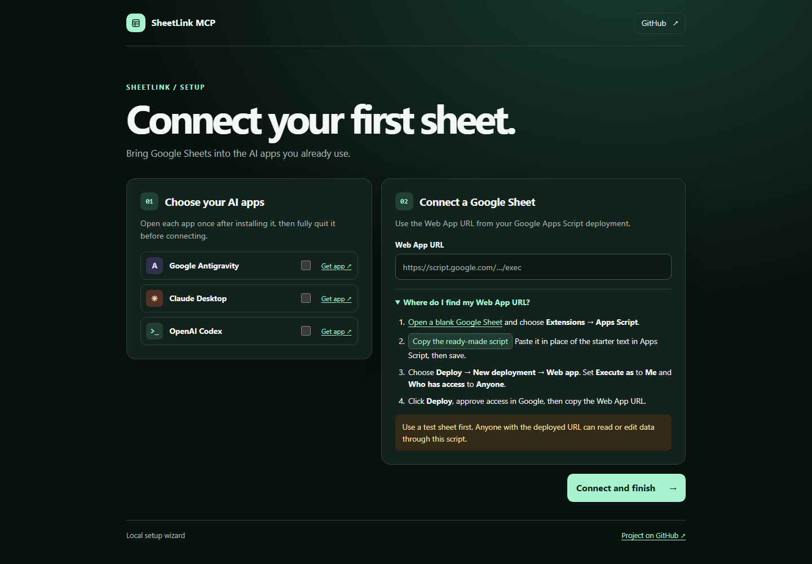

# SheetLink-MCP

Connect a Google Sheet to Claude Desktop, Google Antigravity, or OpenAI Codex. You can ask your AI app to read rows, find records, or make edits you request. The setup wizard runs in your browser and registers the connection in your chosen apps.

## Before you start

- Use a 64-bit Windows PC or an Intel or Apple Silicon Mac with internet access. The launcher prepares Python for you.
- Have a Google account and install at least one of the three desktop AI apps above. Open the app once, sign in if prompted, and fully quit it before running setup.
- Start with a new sheet containing sample data. **Anyone who gets the deployed Web App URL can read or edit the connected spreadsheet through SheetLink.** Keep the URL private and use only data you are comfortable exposing through that link.

## 1. Download and open the setup wizard

1. Open the project's [GitHub Releases page](https://github.com/saikatcloudhere/SheetLink-MCP/releases). When a release is available, open **Assets** and choose the setup ZIP for your computer. If you already received a setup ZIP, use that file.
2. Extract the entire ZIP. On Windows, right-click it and choose **Extract All**. On Mac, double-click it in Finder. Keep the extracted folder in a permanent location.
3. Open the extracted **SheetLink-MCP** folder and launch the file for your computer.

   | Computer | File to open |
   | --- | --- |
   | Windows | `RUN_SETUP.bat` |
   | Mac | `RUN_SETUP.command` |

4. Keep the setup window open while it prepares Python and opens your browser. If the page does not open automatically, copy the address printed in the setup window and paste it into your browser.
5. Under **Choose your AI apps**, tick the apps you want to connect.

## 2. Create a test sheet and get its Web App URL

1. Open a [blank Google Sheet](https://sheets.new). In the first tab, type **Item** in cell A1 and **Notebook** in cell A2. Note the tab name at the bottom. You will use it for the first test.
2. In the sheet's menu, choose **Extensions → Apps Script**. This opens Google's script editor in a new tab.
3. In the SheetLink setup page, open **Where do I find my Web App URL?** and click **Copy the ready-made script**. Back in Apps Script, select all the starter text, paste the copied script, and click **Save**.
4. In Apps Script, click **Deploy → New deployment**. Next to **Select type**, use the gear menu to choose **Web app**.
5. Enter **SheetLink test** as the description. Set **Execute as** to **Me** and **Who has access** to **Anyone**. If your Google account does not offer **Anyone**, check with your Workspace administrator before continuing.
6. Click **Deploy**. If Google asks you to authorize access, choose the account that owns the test sheet and review the permissions.
7. Copy the **Web app URL** from the deployment window. It starts with `https://script.google.com/` and ends in `/exec`.

See Google's [Web Apps guide](https://developers.google.com/apps-script/guides/web) for deployment and permission details.

## 3. Connect and test

1. Return to the SheetLink wizard. Paste the copied address into **Web App URL** and click **Connect and finish**. The wizard checks whether it can read the sheet before registering it.
2. When you see **Connection complete**, fully quit and reopen the apps you connected. Look for `sheetlink-mcp` in the app's MCP or tools settings.
3. In a new chat in that app, send the following message. If your tab has another name, replace **Sheet1** with the name shown at the bottom of your spreadsheet.

   > Use SheetLink to read the Sheet1 tab and tell me what is in cell A2.

4. Approve the tool request if your app asks. The result should include **Notebook**.

## If you get stuck

| What you see | What to try |
| --- | --- |
| The setup page is blank or the old local address is unavailable | Keep the setup window open and use the address it printed for this run. Reopen the launcher if the setup window has closed. |
| macOS says the launcher cannot be executed | If you trust the downloaded files, open Terminal, type `bash` followed by a space, drag `RUN_SETUP.command` into Terminal, then press Return. |
| The wizard asks for a URL ending in `/exec` | Go to Apps Script → **Deploy → Manage deployments** and copy the deployed Web app URL. The normal spreadsheet link and the test URL ending in `/dev` serve different purposes. |
| Google blocks the connection or asks for sign-in | In **Manage deployments**, check the deployment uses **Me** and **Anyone**, and confirm the owner approved access. |
| The wizard reports a script error about a missing or null spreadsheet | Stop at this step and report the error. Google documents that the active spreadsheet may be unavailable when the script runs as a web app. [Google's container-bound script guide](https://developers.google.com/apps-script/guides/bound#special_methods) |
| The AI app cannot find SheetLink | Fully quit and reopen the app. If you moved the extracted folder, run setup again from its new location. |

For help, [open a GitHub issue](https://github.com/saikatcloudhere/SheetLink-MCP/issues) with your operating system, AI app, and the error text. Remove your Web App URL and any spreadsheet data from the report.

## Advanced use

The wizard saves the Web App URL in `config.json` and registers `sheetlink-mcp` with the selected apps. Keep the config file private. Cursor is a manual setup option. Use the setup folder's Python executable to launch `server.py` as an MCP server over stdio. The executable is `.venv/Scripts/python.exe` on Windows or `.venv/bin/python` on Mac. Use full paths in client settings.

| Tool | What it does |
| --- | --- |
| `read_sheet_records` | Reads rows from a worksheet tab. |
| `search_records` | Finds rows that contain a search term. |
| `append_new_row` | Adds a row at the bottom of a tab. |
| `update_cell_by_search` | Finds the first matching row and updates one cell in it. |

The Windows setup ZIP also includes `OPEN_DASHBOARD.bat` for opening the desktop sheet viewer after setup. The source includes a separate UTCP example in `utcp.json`.

Maintained by [Saikat](https://github.com/saikatcloudhere). Distributed under the [MIT License](./LICENSE).
